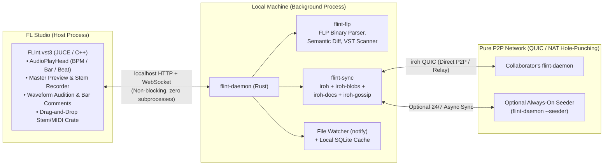

# FLint — Architecture Specification (v2 / Direction C)

> **DAW-Aware, Local-First, Pure-P2P Collaboration for FL Studio**  
> Combining `.flp` project intelligence (semantic musical diffs, missing-plugin detection, deduplicated sync) with VST3 superpowers inside the DAW (bar-synced audio previews, bar-locked comments, and drag-and-drop stem/MIDI sharing).

---

## 1. Product Vision & The Killer Loop

Generic sync tools (Syncthing, Google Drive, Dropbox) treat DAW projects as opaque blobs. They create conflicted copies, re-upload hundreds of megabytes for a one-note change, can't tell you what changed musically, and leave you stranded when your collaborator uses a VST you don't own.

FLint splits collaboration cleanly across **two collaborating components**, so each does only what it is uniquely good at:

1. **A Persistent Local Rust Daemon (`flint-daemon`)** — handles `.flp` parsing, musical diffing, installed-VST scanning, file watching, content-addressed deduplication, and pure-P2P replication.
2. **A Lightweight VST3 Plugin (`FLint.vst3`)** — lives inside FL Studio's audio engine to capture bar-synced audio previews & stems, read live playhead/BPM transport info (`AudioPlayHead`), host bar-locked mix comments, and drag-and-drop shared stems/MIDI straight onto FL Studio's Playlist or Channel Rack.

### The Signature Workflow Loop
1. Producer A edits their FL Studio project and saves (`Ctrl+S`).
2. `flint-daemon` parses the `.flp`, computes a **semantic musical diff** (e.g., *"BPM 128→132, added Serum on Ch 6, edited 'Chorus Chords' (+14 notes)"*), hashes only newly added audio files, and checks against Producer B's advertised VST inventory.
3. FLint warns inside the VST3: *"Alex doesn't have RC-20 on Mixer Insert 5."*
4. Producer A clicks **Capture Stem** in the VST3 (bar-synced automatically to the loop region) and hits **Push**. FLint attaches both a master audio preview and the bounced stem.
5. Producer B opens FLint, auditions v3 vs v4 directly from the waveform preview, reads bar-locked notes (*"Bar 33.1 — snare feels slightly late"*), and **drags the RC-20 stem straight from the FLint VST3 window onto their Playlist**.

---

## 2. Key Technical Decision: Why `iroh` Replaces Hyperswarm in Rust

The original V1 prototype (`sidecar/`) used Node.js + Holepunch (`hypercore` / `hyperswarm` / `corestore`). Moving the daemon to **Rust** gives us a single native binary, zero Node/`pkg` native-addon headaches, and fast binary `.flp` parsing — however, **Hyperswarm and Autobase have no production-ready Rust implementation**.

Instead, FLint v2 uses **[Iroh](https://iroh.computer/) (v1.x)** — a modern, production-grade Rust P2P stack built on QUIC by n0-computer that preserves the exact same pure-P2P, zero-central-database philosophy while solving every V1 limitation natively:

| Requirement | V1 (Node + Hypercore) | V2 (Rust + Iroh) |
|---|---|---|
| **Peer discovery & NAT traversal** | Hyperswarm DHT | `iroh` (dial by 32-byte Ed25519 NodeId over QUIC, UDP hole-punching + relay fallback) |
| **Multi-writer history** | Broken (Hypercore is single-writer; required Autobase) | `iroh-docs` (multi-writer eventually-consistent document store out of the box) |
| **Deduplicated audio/project sync** | Broken (base64 full `.zip` in JSON) | `iroh-blobs` (BLAKE3 content-addressed verified streaming; only new/changed files transfer) |
| **Live peer presence & signals** | Polling CLI every 10s (froze UI) | `iroh-gossip` (lightweight P2P pub-sub for live online/offline status & live notifications) |
| **True offline async P2P** | Impossible when peers aren't online together | Optional **`flint-daemon --seeder`** mode — any self-hosted VPS, Raspberry Pi, or always-on home PC can join a session with a **read-only** ticket as an always-on peer. It is *not* blind: it stores and can read everything (see §6) |

---

## 3. System Architecture



### Core Architectural Rules (Eliminating All V1 Pitfalls)
1. **No Subprocess Spawning:** `flint-daemon` runs as a persistent background service (auto-started on login or launched once if not running). `FLint.vst3` communicates over `http://127.0.0.1:<port>` and `ws://127.0.0.1:<port>/events` on a background network thread — **never blocking JUCE's audio thread or message thread**.
2. **Content-Addressed Storage, Never Zipped Blobs:** Projects are unpacked/read directly from FL Studio project folders (or extracted once if opened from a `.zip`). Every `.flp`, audio sample, preview clip, and stem is hashed with **BLAKE3** into `iroh-blobs`. Changing 1 MIDI note syncs only the ~500 KB `.flp` + metadata.
3. **Separate Metadata from Heavy Blobs:** Version logs, diffs, comments, and crate entries live in `iroh-docs` as tiny JSON records referencing BLAKE3 blob hashes. Reading full version history is instant and uses kilobytes of RAM.
4. **Session Binding Persisted in the DAW Project:** `FLintAudioProcessor::getStateInformation` / `setStateInformation` saves the `session_id` (and project path hint) inside the `.flp`, so reopening a project automatically reconnects to the right FLint session.

---

## 4. Proposed Repository Structure

```text
FLint/
├── ARCHITECTURE.md            ← This document
├── FLint_Dev_Checklist.md     ← Phased implementation checklist
├── README.md                  ← Setup & usage guide
├── daemon/                    ← Rust Cargo Workspace
│   ├── Cargo.toml
│   └── crates/
│       ├── flint-flp/         ← Standalone FL Studio .flp binary parser + diff engine
│       ├── flint-vst-scan/    ← Installed VST2/VST3/CLAP scanner (Windows/macOS)
│       ├── flint-sync/        ← iroh (blobs + docs + gossip) P2P layer + seeder logic
│       ├── flint-core/        ← Shared domain models (Session, Snapshot, Comment, CrateItem)
│       └── flint-daemon/      ← Persistent HTTP/WS server, file watcher, CLI & --seeder mode
├── plugin/                    ← JUCE VST3 Plugin (migrated from Projucer to CMake)
│   ├── CMakeLists.txt
│   └── Source/
│       ├── PluginProcessor.*  ← Audio passthrough, PlayHead tracker, ring-buffer recorder, state
│       ├── PluginEditor.*     ← Main tabbed UI (Timeline, Crate, Plugins, Settings)
│       ├── DaemonClient.*     ← Async HTTP/WebSocket client talking to 127.0.0.1
│       └── UI/                ← Waveform view, Version list, Comments panel, Drag-out Crate
└── sidecar/                   ← (Legacy Node.js V1 prototype — archive/remove once Phase 2 works)
```

---

## 5. Deep Dive Into Subsystems

### 5.1 `flint-flp` — FL Studio `.flp` Binary Parser & Musical Diff Engine
FL Studio's `.flp` format consists of two chunks:
- **`FLhd` (Header):** 6-byte payload containing format version, channel count, and PPQ (pulses per quarter note).
- **`FLdt` (Data):** A Type-Length-Value (TLV) event stream partitioned by event ID byte:
  - `0..=63` → 1-byte value (`u8`)
  - `64..=127` → 2-byte value (`u16`)
  - `128..=191` → 4-byte value (`u32` / `f32`)
  - `192..=255` → varint length-prefixed payload (strings, plugin state, pattern note arrays, automation)

**What `flint-flp` extracts into a normalized `ProjectManifest`:**
- FL Studio version string, BPM, time signature, PPQ, project title
- **Channels:** index, name, type (Sampler / Generator / Automation), plugin name, referenced sample path
- **Mixer Inserts:** index, name, volume/pan, ordered list of FX slot plugin names (native + VST wrapper plugin names)
- **Patterns:** index, name, note count & hash of MIDI note events
- **Audio Assets:** complete deduplicated set of referenced audio sample paths

**Semantic Diffing (`diff(prev: &ProjectManifest, next: &ProjectManifest) -> MusicalDiff`):**
Produces human-readable structured changes automatically on every push:
- Tempo / FL version changes
- Added / removed / renamed channels and plugins
- Added / removed FX on specific mixer inserts
- Modified / added / removed patterns (with note deltas)
- Added / removed audio sample dependencies

### 5.2 Missing-Plugin & Environment Compatibility Guard
- `flint-vst-scan` scans standard plugin directories (`C:\Program Files\Common Files\VST3`, VST2 paths, FL Studio native plugin list) and caches the local machine's installed plugins.
- Each peer publishes its installed plugin list + FL Studio version into the session's `iroh-docs` namespace (`peers/<node_id>/env`).
- Before pushing or pulling, `flint-daemon` cross-references the `.flp`'s plugin inventory against every collaborator's `env` record and flags:
  - Missing third-party VSTs (with exact Channel or Mixer Insert number so you know which track to stem-capture!)
  - FL Studio version mismatches (e.g., saving in FL 2024.2 while a peer is on FL 2024.1)

### 5.3 `flint-sync` — Data Model on `iroh-docs` + `iroh-blobs`
Every FLint collaboration session corresponds to one `iroh-docs` namespace (shared via an invite ticket string, e.g. `flint1...`).

**Keys stored inside the session's `iroh-docs` namespace:**
- `meta/session` → `{ name, created_at, created_by }`
- `peers/<author_id>/env` → `{ display_name, fl_version, installed_plugins: [...], updated_at }`
- `snapshots/<timestamp_ulid>_<author_id>` →
  ```json
  {
    "id": "01J...",
    "parent_ids": ["01H..."],
    "author": "alex",
    "created_at": 1763915400,
    "note": "Tightened chorus drums + new lead",
    "flp_blob": "<blake3>",
    "flp_filename": "midnight_drive.flp",
    "manifest": { "bpm": 132.0, "fl_version": "24.2.1", "plugins": [...], "samples": [...] },
    "diff_summary": ["BPM 128 → 132", "Added Serum on Ch 6", "Mixer 5: +RC-20"],
    "assets": {
      "Samples/vox_hook.wav": "<blake3>",
      "Samples/808_punch.wav": "<blake3>"
    },
    "preview_audio_blob": "<blake3 | null>",
    "preview_peaks": [0.12, 0.48, 0.91, ...]
  }
  ```
- `comments/<snapshot_id>/<ulid>` →
  ```json
  {
    "id": "01J...",
    "author": "kshri",
    "bar": 33,
    "beat": 1.0,
    "time_sec": 60.0,
    "text": "Snare feels a touch late here",
    "resolved": false,
    "created_at": 1763915900
  }
  ```
- `crate/<ulid>` →
  ```json
  {
    "id": "01J...",
    "author": "alex",
    "kind": "stem" | "midi" | "preset",
    "name": "Ch5_RC20_Guitar_132bpm_8bars.wav",
    "bpm": 132.0,
    "start_bar": 17,
    "length_bars": 8,
    "source_track": "Mixer Insert 5",
    "blob": "<blake3>",
    "peaks": [...],
    "created_at": 1763915600
  }
  ```

**Why this data model works cleanly for multi-writer P2P:**
- Every snapshot, comment, and crate item has a unique `(timestamp_ulid, author_id)` key — **concurrent pushes from two collaborators never overwrite each other**. Both snapshots appear in the timeline as parallel branches with `parent_ids` preserved.
- Because `assets` maps relative paths to BLAKE3 hashes, `iroh-blobs` automatically skips downloading any sample you already have locally.

### 5.4 Localhost IPC Contract (`flint-daemon` ↔ `FLint.vst3`)
Base URL: `http://127.0.0.1:47821` (configurable, written to `%LOCALAPPDATA%\FLint\daemon.json` with a random local auth token so random websites can't hit the daemon).

**REST Endpoints:**
- `GET /health` → daemon version, NodeId, uptime
- `POST /sessions` → create a new session bound to a local project directory, returns `{ session_id, invite_ticket }`
- `POST /sessions/join` → join via `invite_ticket` + target local directory
- `GET /sessions/:id/state` → peers (online/offline), latest snapshots, plugin compatibility report, crate items, comments
- `POST /sessions/:id/push` → parses current `.flp`, diffs vs parent, ingests new asset blobs + optional captured preview WAV, publishes snapshot
- `POST /sessions/:id/pull/:snapshot_id` → downloads missing blobs via `iroh-blobs`, materializes version into a clean local folder (never silently clobbering unsaved work), returns path + option to open in FL Studio
- `POST /sessions/:id/comments` → add/resolve bar-locked comment
- `POST /sessions/:id/crate` → upload captured stem WAV / MIDI / preset into the shared crate
- `GET /blobs/:hash/path` → ensures blob is materialized on local disk and returns a safe local file path (used by JUCE for waveform playback and native OS drag-and-drop into FL Studio!)

**WebSocket Stream (`ws://127.0.0.1:47821/events`):**
Pushes real-time events to the VST3 UI with zero polling:
- `peer_presence` (`online` / `offline` / `syncing`)
- `snapshot_received` (new version arrived from collaborator)
- `sync_progress` (`{ blob_hash, bytes_done, bytes_total }`)
- `comment_added`
- `crate_item_added`
- `flp_modified_on_disk` (triggers "Unpushed changes ready" badge + live diff preview inside the plugin!)

### 5.5 VST3 Audio Engine Design (`FLint.vst3`)
- **Zero-latency transparent passthrough** in `processBlock()` — FLint never colors your mix.
- **Lock-free Ring Buffer (`juce::AbstractFifo`):** When Capture Mode is armed (either for a version preview on Master or a stem capture on a mixer insert), `processBlock()` copies float samples into a lock-free FIFO while tracking `AudioPlayHead::PositionInfo` (BPM, PPQ position, bar/beat start, playing state).
- A dedicated **background writer thread** drains the FIFO to a temporary `.wav` (or lossless `.flac`) file, computes waveform peaks, and POSTs it to `flint-daemon`. **Zero allocations, zero disk I/O, and zero locks ever happen on the audio thread.**
- **Drag-and-Drop to Playlist:** Clicking and dragging any item in the **Shared Crate** calls `juce::DragAndDropContainer::performExternalDragDropOfFiles({ localFilePath }, false)` so the producer can drop stems, vocals, MIDI clips, or `.fst` presets straight onto FL Studio's Playlist or Channel Rack.

---

## 6. Always-On Seeder Mode (Optional Self-Hosted Async)

To keep FLint 100% pure P2P while still supporting true offline async collaboration (Producer A pushes at 2 AM, shuts down laptop, Producer B wakes up at 9 AM and pulls):
- `flint-daemon` ships with a headless `seeder` command:
  ```bash
  flint-daemon session share <session_id> --read-only      # on your machine
  flint-daemon --data-dir /var/lib/flint-seeder seeder --add <read-only ticket>
  ```
- You (or a team/studio) can run this single Rust binary on a \$4/mo VPS, Raspberry Pi, or home NAS.
- It joins the session's `iroh-docs` namespace, downloads every snapshot's files on a loop (`--prefetch-interval-secs`, default 60), and serves them over QUIC whenever any collaborator comes online — no custom cloud backend or SaaS lock-in required.
- Write tickets are downgraded to read-only before being used or saved unless `--allow-write` is passed, so a compromised seeder cannot rewrite session history.

## 7. Security Model (what FLint does and does not protect)

- **Invite tickets.** A write ticket lets the holder add snapshots, comments, and crate items forever. A read-only ticket (`session share --read-only`) lets them sync and download only. Tickets also contain your IP addresses unless you use `--hide-ip`.
- **The session ID is a read key.** In iroh-docs the namespace ID is the read capability: anyone who has it and can reach a peer can sync the session. Treat it like a ticket. This matters for Phase 4, which plans to save the session ID inside the `.flp` — sharing that `.flp` outside the group would share read access.
- **No revocation.** iroh-docs cannot revoke a ticket. `session rotate` copies the history into a new namespace and stops syncing the old one; send the new ticket only to the people who should keep access. Removed people keep everything they had before the rotation.
- **Seeders are not blind.** Files and metadata are stored unencrypted, so whoever runs a seeder can read the project. Making seeders blind needs client-side encryption with a session key that is never given to the seeder (not implemented).
- **Blob serving.** `iroh-blobs` serves any stored file to any peer that asks for its BLAKE3 hash. Hashes are only learned by reading the session, so this is fine for trusted groups, but it is another reason to keep session IDs private.
- **Transport.** All traffic is QUIC with TLS keyed by each node's Ed25519 identity. n0's public relays forward encrypted packets when direct hole-punching fails; they cannot read them.

## 8. Disk Usage

Files are kept by FLint *tags* (`flint/s/<session_id>/<hash>`) and blob garbage collection runs every 10 minutes in the daemon. A file is deleted only when no FLint tag and no iroh-docs entry references it. `session prune --keep N` releases the tags of files that only snapshots older than the newest N need; history records are never deleted and other collaborators are unaffected. Pulling an old snapshot later re-downloads its files from any peer that still has them.

Sessions created before v0.2.1 registered every file under a `blobs/<hash>` doc entry; those files stay pinned by the doc and cannot be pruned. `session rotate` starts a clean session without that registry.
